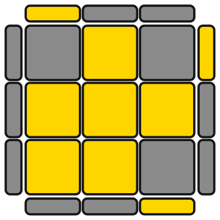
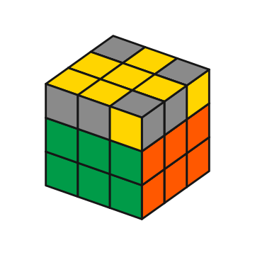
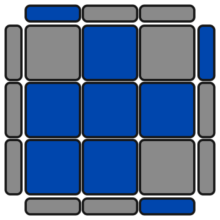

# Cube Trainer for Anki

Flashcards for Rubik's Cube algorithms with **cube pictures generated from the algorithm** and an **animated player**.
You type the algorithm once. The add-on works out the case, draws it, and animates the solution.
The picture and the algorithm can never disagree, and you never have to screenshot a case again.

| Question side | Answer side (3D, animated) | Any colour scheme |
|---|---|---|
|  |  |  |

## Features

- **Generated pictures:** top-down (like OLL cheat sheets), bottom (face-down) and 3D views.
- **Animated player:** play/pause, step back/forward, jump to end, speed, optional autoplay and loop, tap any move in the algorithm to jump to it.
- **Stages:** grey out the pieces that are not part of the step you are learning (`oll`, `coll`, `cmll`, `f2l`, `cross`, or `full`).
- **Any colour scheme:** choose the cross colour (for example green instead of white), the front colour, or your own hex colour for each of the six colours.
- **Bundled CFOP sets:** F2L (41), OLL (57), PLL (21) and COLL (40), plus 2-look OLL. One card per case, one algorithm per case, sorted into sub-decks by group (for example `OLL::Dot Case`, `COLL::Sune`, `PLL::EPLL`).
- **Your own algorithms:** paste `Name | algorithm` lines to make cards for COLL, ZBLL, F2L, or anything else.
- **Works wherever your cards go:** all drawing code lives inside the card templates, so synced cards are designed to work in Anki desktop, AnkiDroid and AnkiMobile. No internet connection needed.

## Install

**From AnkiWeb:** Tools > Add-ons > Get Add-ons..., enter the code shown on the add-on's AnkiWeb page, and restart Anki.

**From a file:** download `cubetrainer.ankiaddon`, then Tools > Add-ons > Install from file....

**Phone only, or no add-on:** import `Cube_Trainer_starter.apkg`. It carries the note type and all bundled cards, and needs no add-on to review.

Requires Anki 2.1.50 or newer. The add-on itself runs on desktop only. Anki add-ons cannot run on mobile, but the cards it creates sync to your phone like any other cards.

## Quick start

1. **Tools > Cube Trainer > Import algorithm sets...** and tick what you want (2-look OLL is selected by default).
2. Open the deck and review. The question side shows the case, and the answer side shows the 3D cube and plays the algorithm.
3. **Tools > Cube Trainer > Settings...** to change colours, views and animation. After saving, sync so your phone gets the updated templates.

## Cards

| Card | Question | Answer |
|---|---|---|
| **Case to Alg** | The case picture | Name, 3D cube, animated algorithm, notes |
| **Alg to Case** | The algorithm as text (only for notes whose **Reverse** field is filled) | The case picture |

## Fields of the "Cube Case" note type

| Field | Meaning |
|---|---|
| Name | Shown on the answer, for example `OLL 21` or `Sune 3` |
| Set | Small label on the question, for example `OLL` or `PLL` |
| Alg | The algorithm. The case is derived from it automatically |
| Scramble | Optional. Use this instead of "the inverse of the alg", for example for algs that only solve part of the cube |
| Stage | `full`, `oll`, `coll`, `cmll`, `f2l` or `cross` |
| View | Blank or `top` = top face, `bottom` = turn the cube over to show the D face, `flip` = 3D view with the cube flipped, `3d` = 3D only (used by the F2L cards) |
| Cross | Optional per-note cross colour: `white`, `yellow`, `green`, `blue`, `red` or `orange` |
| Orient | Optional per-note extra whole-cube rotation for the picture, for example `y` or `y2` |
| Notes | Free text shown on the answer (HTML allowed) |
| Reverse | Put any text here to also get an Alg to Case card |

## Algorithm notation

Supported: face turns `U D F B R L`, wide moves (`r` or `Rw`), slices `M E S`, rotations `x y z`, primes (`R'`), double turns (`R2`, `R2'`), and parentheses (ignored).
Not supported: commutator notation such as `[A, B]`. Expand those to plain moves first.
A mistyped move shows a small red message on the card, for example `Cube viewer: Unknown move: Q`.
If an alg contains cube rotations (such as the leading `x` in some PLL algs), the case is drawn with the last layer on top, which is what you want.

## Stages and views

- `oll` shows only which stickers are oriented. `coll` shows the corners in full and the edges as oriented or not. `cmll` shows corners only. `f2l` hides the last layer. `cross` shows only the cross pieces. `full` shows everything.
- The question side defaults to the flat top-down diagram and the answer side to flat plus 3D. Both can be changed in Settings.

## Bundled algorithms

| Set | Cases | Sub-decks |
|---|---|---|
| F2L | 41 | Free Pairs, Disconnected Pairs, Connected Pairs, Corner In Slot, Edge In Slot, Pieces In Slot |
| OLL | 57 | Dot Case, Square Shapes, Lightning Shapes, Fish Shapes, Knight Move Shapes, OCLL, All Corners Oriented, Awkward Shapes, P Shapes, T Shapes, C Shapes, W Shapes, L Shapes, Line Shapes |
| PLL | 21 | Adjacent Swap, Opposite Swap, EPLL |
| COLL | 40 | Sune, Anti-Sune, H, L, Pi, T, U |
| 2-look OLL | 10 | Edges (3) and corners (7) |

- Each case has exactly **one** algorithm (the first one listed by SpeedCubeDB for the case). Edit the **Alg** field to use your own preferred algorithm. The picture follows automatically.
- Pictures are generated from the algorithm, so they always match it. For PLL and COLL the picture is aligned to the most standard-looking position, and the answer's Notes tells you when to finish with an AUF.
- F2L cards use the 3D view (the pair is shown in the front-right slot) and the `f2l` stage, which greys out the last layer.
- Every bundled algorithm is machine-checked by `tests/test_sets.js` against an independent cube model: F2L pieces stay intact, OLL has 57 distinct patterns, PLL has 21 distinct cases, COLL algs solve the corners with edges oriented, and every F2L case is a single-slot case.
- The 2-look OLL algorithms are this project's own standard choices.

### Credit and licensing of the algorithm lists
The algorithm choices follow the lists on [SpeedCubeDB](https://www.speedcubedb.com) by Gil Zussman. Individual algorithms are move sequences shared across the cubing community, but if you redistribute this add-on, check SpeedCubeDB's terms and credit them. The add-on's code is MIT licensed.

## Settings and config

Open **Tools > Cube Trainer > Settings...** for the common options (cross colour, front colour, views, speed, autoplay, loop).
Everything else is in **Tools > Add-ons > Cube Trainer > Config**:

| Option | Default | Meaning |
|---|---|---|
| `cross_color` | `white` | Colour on the face-down (D) side: white, yellow, green, blue, red, orange |
| `front_color` | `""` | Colour on the front face, or automatic |
| `colors` | standard | Hex value for each colour name. Match your own stickers, for example `"red": "#d11b79"` |
| `grey_color` | `#8a8a8a` | Colour of pieces greyed out by a stage |
| `body_color` | `#161616` | Cube body and the gaps between stickers |
| `view` | `top` | Default picture orientation: `top`, `bottom` or `flip` |
| `stage` | `""` | Default stage for notes with an empty Stage field |
| `orient` | `""` | Extra whole-cube rotation for every picture, for example `y` |
| `front_show` / `back_show` | `flat` / `both` | What the question / answer side shows: `flat`, `3d` or `both` |
| `speed`, `move_ms` | `1`, `420` | Animation speed multiplier and quarter-turn length in milliseconds |
| `autoplay`, `loop` | `true`, `false` | Animation behaviour on the answer side |
| `reverse_cards` | `false` | Also create Alg to Case cards when importing |
| `deck_root` | `Cube Trainer` | Parent deck used by the import dialogs |
| `default_sets` | 2-look OLL | Sets pre-ticked in the import dialog |

Settings are baked into the card templates when you press Save (or run **Install / update note type**), so sync afterwards to update your phone. Your notes are never changed.

## How it works

Anki add-ons cannot run on mobile, so the add-on only creates the note type and notes. The drawing and animation code (plain JavaScript and SVG, about 30 KB) is stored inside the card templates, so it works wherever your collection syncs. There is no WebGL, no media files and no network access.
Anki treats `{{` and `}}` in templates as field tags, so the script is sanitised before it is inlined.

## Privacy

No network access, no telemetry, no data leaves your computer. The add-on only reads and writes your Anki collection (the "Cube Case" note type and the notes you import) and its own config.

## Troubleshooting

- **Red "Cube viewer: Unknown move" message:** there is a typo in the **Alg** field.
- **Settings changes do not show on my phone:** sync Anki on desktop first, then sync on the phone.
- **Nothing is drawn on a very old Anki or phone WebView:** please open an issue with your Anki version and device.
- **I want to start over:** Tools > Cube Trainer > Install / update note type refreshes the templates without touching your notes.

## Development

```
pip install -r requirements-dev.txt
npm install
bash tests/run_all.sh        # rebuilds the sets, then engine, algorithm, Anki render, browser (jsdom) and GUI tests
python3 build.py             # writes dist/cubetrainer.ankiaddon and the starter deck
```

Layout: `cubetrainer/` is the add-on (`core.py` has all the logic and no GUI imports, `__init__.py` is the menu and dialogs, `cubeviz.js` is the cube engine, renderers and player). `tools/cfop_algs.txt` is the algorithm list and `tools/build_sets.js` turns it into `cubetrainer/algsets.json`. See `CHANGELOG.md` for history.

## Contributing

Issues and pull requests are welcome, especially: more algorithm sets, notation support, and reports from different Anki versions and devices.

## License

MIT, see `LICENSE`.
#
